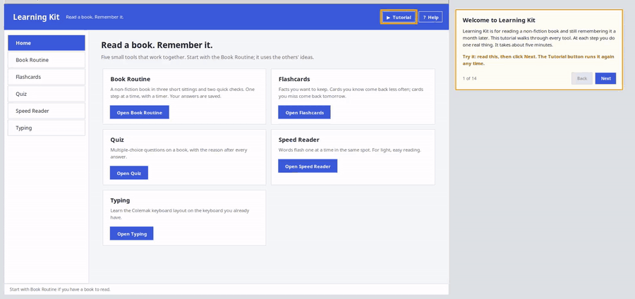
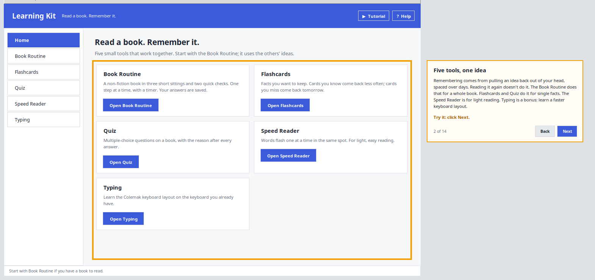
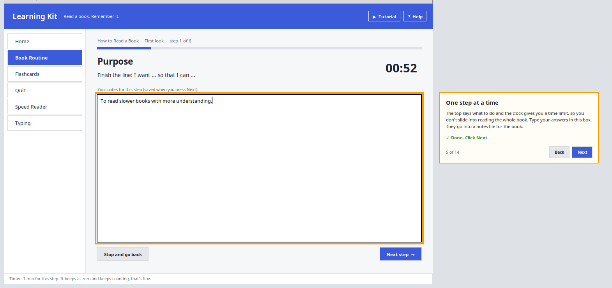
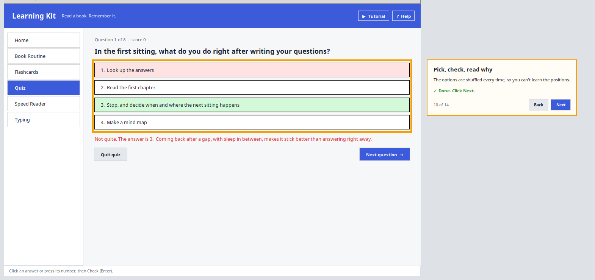
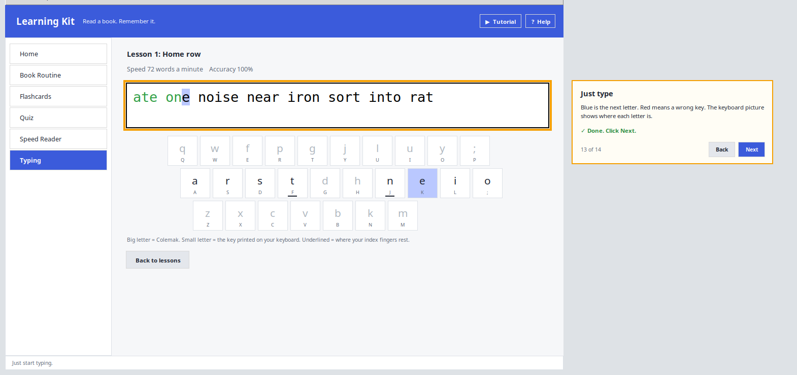

# Learning Kit

**Read a non-fiction book, and still know what it said a month later.**

Five small tools in one window: a step-by-step routine for working through a book, flashcards, quizzes, a speed reader for light reading, and a typing trainer. Free, offline, no account. Runs on Windows, Mac and Linux.



*The first time you open it, a tutorial walks you through every tool, and you do one real thing at each step. ([Full video](docs/tutorial.mp4))*

---

## Why this exists

Most of us have finished a good book and, two weeks later, couldn't say three things it taught us. The reading happened. The remembering didn't.

We ran into this the hard way. We took a well-known weekend speed-reading course, used its methods on our own reading, and kept notes. Some parts clearly helped:
- looking at how a book is built before reading it
- writing questions first
- coming back to the book after a night's sleep
- explaining the book out loud afterwards

Other parts we couldn't get to work reliably. The course's central promise is taking in whole pages at a glance. When we went looking, the research doesn't support it (Rayner et al. 2016, below).

So we did what the course didn't: **we checked every step against reading and memory research.** That came to about 30 studies and reviews. We kept what holds up, made the shaky parts optional, and dropped what the evidence goes against. The result is a routine anyone can follow without taking a course. It takes about an hour of reading time per book, spread over a month.

The core finding behind all of it is one of the best-replicated results in learning research:

> **You remember what you pull back out of your head, spaced over days. You don't remember what you read again and again in one sitting.**

Re-reading and highlighting *feel* productive, but they rate "low" for learning. Testing yourself and spreading study out are the only two of ten common study methods rated "high" (Dunlosky et al. 2013). Every tool here is built on that.

## What it can replace

Learning Kit is built to be a free, offline alternative to the usual mix of apps people use to "learn from books". Each of these is good at something. None of them covers the whole job of taking a book from first look to remembered.

| If you use… | It's good at… | What's missing, and what Learning Kit does instead |
|---|---|---|
| **Anki** | Spaced flashcards, very flexible | It starts blank, so you decide what's worth a card and how to read the book. Here the **Book Routine** produces the questions as you read, and **Flashcards** handle the facts. |
| **Quizlet** | Making and sharing study sets | It's built around studying a set now. Here the **Quiz** shows *why* after every answer and drills only the ones you missed. Your history stays on your computer. |
| **Blinkist** and other book-summary apps | The gist of a book in 15 minutes | Reading someone else's summary is re-reading. You recall nothing yourself, so little of it sticks. Here you write the answers from memory, in your own words. |
| **Readwise** and other highlight-review apps | Resurfacing your highlights | Seeing a highlight again is still re-reading. Here the **checks after a week and a month** make you answer from memory first, then look. |
| **Spreeder** and other speed-reading apps | Pushing your words-per-minute up | Flashing words removes your ability to glance back, so you understand less of hard text. Here the **Speed Reader** is honest about that. It's for light reading, and Left jumps back a sentence. |

## The tools

| Tool | What it does |
|---|---|
| **Book Routine** | Takes a non-fiction book through three short sittings and two checks, one step at a time, each with a timer. Your answers go into a Markdown file per book. |
| **Flashcards** | Spaced review from a plain text file (`question :: answer`). Cards you know come back less often. |
| **Quiz** | Multiple choice from a JSON deck, with the reason after every answer. Drills the ones you missed. |
| **Speed Reader** | One word at a time in the same spot. For light reading. |
| **Typing** | Learn the Colemak keyboard layout on your normal keyboard, with no settings changed. |

## Start

You need Python 3.9 or newer.
- **Windows and Mac:** the installer from [python.org](https://www.python.org/downloads/) includes everything.
- **Linux:** also run `sudo apt install python3-tk` (or your distro's equivalent).

```
git clone https://github.com/sebaytlabs/learning-kit
cd learning-kit
python3 learning_kit.py
```

The first time, a **tutorial** runs by itself. A ring shows one part of the window at a time, a card beside it says what that part is for, and you do one real thing before moving on:
1. Add a book.
2. Start its first sitting.
3. Review a flashcard.
4. Answer a quiz question.
5. Try the speed reader.
6. Type a few letters in Colemak.

It takes about five minutes. The **▶ Tutorial** button runs it again any time. **F1** on any page explains that page.

Your data lives in `~/.learning-kit/`: book progress, notes, card progress and quiz history. Set `LEARNING_KIT_HOME` to keep it somewhere else, such as a synced folder.

## The book routine, step by step

| When | Sitting | Time |
|---|---|---|
| Day 1 | **First look:** purpose, preview, optional skim, key words, 3 to 5 questions. Then stop. | ~20 min |
| Day 2 | **Find the answers:** for each question, guess first, find the place, skim, read it properly, write the answer from memory. | ~25 min |
| Day 4 | **Say it back:** two minutes out loud with the book closed, answer every question again, fix, pick one action. | ~20 min |
| Week 2 | **Check:** answer every question from memory. | 5 min |
| Month 1 | **Check:** same again. Then the book is done. | 5 min |

The app shows what's due today, runs a timer for each step and books the next sitting when you finish one. If you stop halfway, what you wrote is kept and the sitting stays due.

**A worked example.** Say you're reading a book on sleep:
- **Monday (First look).** You write your purpose: *"I want to fall asleep faster so that I'm not wrecked at work."* The contents show three parts. The index keeps pointing to *light*, *caffeine* and *temperature*. You write three questions: *Why does caffeine at 3pm still matter at 11pm? How does light reset the clock? What room temperature helps, and why?* Then you stop. That took 20 minutes, and you haven't "read" anything yet.
- **Tuesday (Find the answers).** For each question you guess out loud, find the pages, read them properly, close the book and write the answer from memory.
- **Thursday (Say it back).** You explain the book out loud for two minutes, answer all three again, and pick one action: *no coffee after noon, starting tomorrow.*
- **A week and a month later.** Five minutes each, answering from memory.

The book is done, and you still know what it said.

### Why each step is there

| Step | Why | Evidence |
|---|---|---|
| **A purpose first** | Reading toward a stated goal steers what you notice. | |
| **Preview: how is the book built?** | Using a text's structure is one of the larger effects in reading research. | Hebert et al. 2016, 45 studies, mostly school-age readers |
| **Questions before reading, and guess before you look** | Questions asked before reading raise what you learn about them, even when your first guess is wrong. Why and how questions do the most. | Pan & Carpenter 2023; Bisra et al. 2018, 64 studies |
| **Stop, and come back tomorrow** | A gap between sittings, with sleep in between, strengthens memory. It feels slower, which is why people skip it. | Carpenter, Pan & Butler 2022 |
| **Write answers from memory** | Recalling is the most effective study method tested. Quizzing yourself beats re-reading by about half a standard deviation. | Dunlosky et al. 2013; Yang et al. 2021, 222 studies |
| **Read the answer at normal pace, and go back if you need to** | Going back over words is part of understanding. When readers were stopped from looking back, comprehension fell. | Schotter, Tran & Rayner 2014; Rayner et al. 2016 |
| **Explain it out loud** | Explaining gives a small gain, and saying it beats writing it. | Lachner et al. 2021 |
| **Two spaced checks** | Students who recalled each answer once in each of three spaced sessions kept 68% a week later. Those who recalled each three times in one session kept 26%. | Rawson et al. 2018, reviewed in Rawson & Dunlosky 2022 |
| **No music with words** | Lyrics hurt reading. Music without words is about neutral. | Vasilev et al. 2018 |
| **Five quiet minutes after** | Rest after learning seems to help. Promising, still debated. | |

**What we left out:**
- **Taking in pages at a glance.** The eye can only see a few letters sharply at a time, and no study we found shows meaning being taken in from whole pages without reading them. The skim in the First look is there to show you how the book is laid out. It doesn't absorb it. If flipping every page helps you settle in, keep it; it's marked optional.
- **"Learning styles" and left-brain/right-brain claims.** These are well-documented myths (Pashler et al. 2008).

### About speed reading

The speed reader is honest about what it's for. Showing words one at a time feels fast, but it takes away the glances back that reading depends on, so you understand less of hard material. The large review on this concludes that doubling or tripling reading speed without losing comprehension is unlikely (Rayner et al. 2016). Use it for light reading, and press **Left** to jump back a sentence whenever you need it.

### About the flashcard schedule

Cards you know come back after 1, 2, 4, 8, 16 and then 32 days. Spacing your reviews out matters a lot. The exact schedule matters much less: experiments find growing gaps and equal gaps about the same over the long run (Karpicke & Roediger 2007; Latimier et al. 2021). We use growing gaps because they keep the daily pile small.

### About Colemak

Colemak is a keyboard layout that puts about three-quarters of your typing on the home row, against about a third on QWERTY, so your fingers travel less. Whether that makes you *faster* is not well established. Most of the case for it is comfort. Expect your speed to drop for several weeks while you learn. The Typing page lets you try it without changing any settings, so you can decide before you commit.

## Make your own decks and cards

Both can be made inside the app: **New card file** and **Add cards** on the Flashcards page, and **New deck** on the Quiz page. Your own files are kept in `~/.learning-kit/my-cards/` and `~/.learning-kit/my-decks/`. The file formats are below if you'd rather write them by hand.

**Cards:** a `.txt` file, one card per line:

```
What is spaced review? :: Seeing a card again just before you'd forget it
```

**Quiz deck:** a `.json` file:

```json
{"title": "My book", "questions": [
  {"q": "Question?", "options": ["right", "wrong", "wrong"], "answer": 0, "why": "Because ... (p. 12)"}
]}
```

`answer` is the position of the right option, counting from 0. Options are shuffled every run.

## Screenshots


*Home: five tools, and the tutorial card beside the window.*


*A Book Routine sitting: one step, a timer, and a box for your answer.*


*Quiz: every answer shows why, with its source.*


*Typing: learn Colemak on your normal keyboard.*

## Related tools

These come from the same studio and the same problem: learning a lot with little time.

- **[Transcribe Folder](https://github.com/sebaytlabs/transcribe-folder).** Turn lectures, courses and talks into searchable text, then pull your questions and cards from it.
- **[SimpleBrain](https://github.com/sebaytlabs/simplebrain).** A notes app with a *Learning Note* for each book. Each sitting becomes a task that appears on its day, and the notes link to everything else you know.
- **[Day Blocks](https://github.com/sebaytlabs/day-blocks).** Give reading a fixed block in your week, so the sittings actually happen.

## Limits, plainly

- The evidence behind the routine mostly comes from students and short texts. Whole books over a month are a reasonable extension, not a tested one.
- The app doesn't know your book. The questions and answers are yours, and their quality is what you get out.
- No sync between devices. Point `LEARNING_KIT_HOME` at a synced folder if you need that.

## Sources

- Bisra, K., et al. (2018). Inducing self-explanation: a meta-analysis. *Educational Psychology Review*, 30, 703–725.
- Carpenter, S. K., Pan, S. C., & Butler, A. C. (2022). The science of effective learning with spacing and retrieval practice. *Nature Reviews Psychology*, 1, 496–511.
- Dunlosky, J., et al. (2013). Improving students' learning with effective learning techniques. *Psychological Science in the Public Interest*, 14(1), 4–58.
- Hebert, M., et al. (2016). Effects of text structure instruction on expository reading comprehension: a meta-analysis. *Journal of Educational Psychology*, 108(5), 609–629.
- Karpicke, J. D., & Roediger, H. L. (2007). Expanding retrieval practice promotes short-term retention, but equally spaced retrieval enhances long-term retention. *JEP: Learning, Memory, and Cognition*, 33(4), 704–719.
- Lachner, A., et al. (2021). Learning by explaining orally or in written form? *Learning and Instruction*, 74.
- Latimier, A., Peyre, H., & Ramus, F. (2021). A meta-analytic review of the benefit of spacing out retrieval practice episodes on retention. *Educational Psychology Review*, 33, 959–987.
- Pan, S. C., & Carpenter, S. K. (2023). Prequestioning and pretesting effects: a review. *Educational Psychology Review*, 35, 97.
- Pashler, H., et al. (2008). Learning styles: concepts and evidence. *Psychological Science in the Public Interest*, 9(3), 105–119.
- Rawson, K. A., & Dunlosky, J. (2022). Successive relearning: an underexplored but potent technique. *Current Directions in Psychological Science*, 31(4), 362–368.
- Rayner, K., Schotter, E. R., Masson, M. E. J., Potter, M. C., & Treiman, R. (2016). So much to read, so little time: how do we read, and can speed reading help? *Psychological Science in the Public Interest*, 17(1), 4–34.
- Schotter, E. R., Tran, R., & Rayner, K. (2014). Don't believe what you read (only once): comprehension is supported by regressions during reading. *Psychological Science*, 25(6), 1218–1226.
- Vasilev, M. R., Kirkby, J. A., & Angele, B. (2018). Auditory distraction during reading: a Bayesian meta-analysis. *Perspectives on Psychological Science*, 13(5), 567–597.
- Yang, C., et al. (2021). Testing (quizzing) boosts classroom learning: a systematic and meta-analytic review. *Psychological Bulletin*, 147(4), 399–435.

## Tests

```
python3 -m unittest discover tests
```

## License

MIT. Made by [Sebayt Labs](https://sebaytlabs.com). We build free tools when the usual ones are too expensive, too complicated, or don't do the job.
